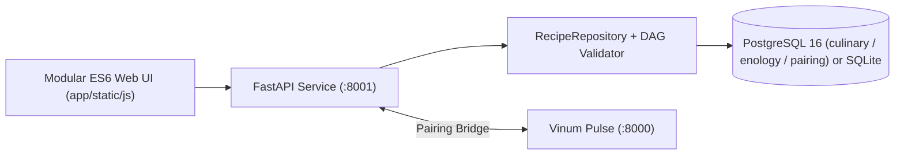

# Mise en Place MD


Technical culinary R&D and recipe engineering platform featuring baker's percentage scaling, acyclic sub-recipe dependency graphs (DAG), thermal critical control points, and bidirectional wine-pairing integration with Vinum Pulse over a shared 3-schema PostgreSQL 16 architecture.

## Architecture



- **Dual Persistence Mode**: Starts immediately with local SQLite (`mise_en_place.db`) for zero-dependency evaluation, and upgrades transparently to shared PostgreSQL 16 (`culinary`, `enology`, and `pairing` schemas managed with Alembic) with Spanish `tsvector` + GIN full-text search.
- **Sub-Recipe Integrity**: Enforces cycle-free directed acyclic graphs (`SubrecipeCycleError` -> `422 Unprocessable Entity`) before persisting chained stocks, mother sauces, or dough bases.
- **Zero-Bundler Modular Frontend**: Event-delegated native ES Modules (`app/static/js/*.js`) verified via `node --test`.

## Tech Stack

| Layer | Technology | Role |
| :--- | :--- | :--- |
| Runtime & API | Python 3.12 · `uv` · FastAPI · Pydantic v2 · `pydantic-settings` | Typed REST API, Markdown import/export, and lifecycle seeding |
| Persistence | PostgreSQL 16 + SQLAlchemy 2.0 + `psycopg` v3 + Alembic (SQLite fallback) | Multi-schema storage, FTS ranking, and versioned migrations |
| Frontend | Semantic HTML5 · CSS Tokens · Native ES Modules (`app/static/js/`) | Culinary workspace, scaling engine, and integrated step timers |
| Quality & SecOps | Ruff · Mypy (`--strict`) · Bandit · Pytest (`>=85%`) · `node:test` · Gitleaks | Level `L2` deterministic verification |

## Quick Start

### Prerequisites
- WSL 2 / Linux with `uv`, `make`, Node.js (`>= 20` for frontend module tests), and Docker (optional, for shared PostgreSQL 16 or full container execution).

### Option A — Instant Local Start (SQLite Default, Zero Containers)
```bash
make install
make dev
```

### Option B — Local Start with Shared PostgreSQL 16
```bash
cp .env.example .env
make dev-pg
```

- **Application Workspace**: `http://127.0.0.1:8001`
- **Interactive OpenAPI Docs**: `http://127.0.0.1:8001/docs`
- **Health Probe**: `http://127.0.0.1:8001/healthz`

### Option C — Full Hardened Docker Compose Stack
```bash
cp .env.example .env
make docker
```

## Configuration

Configured via environment variables or `.env` (see `.env.example`):

| Variable | Default | Description |
| :--- | :--- | :--- |
| `MISE_PORT` | `8001` | HTTP bind port (coexists alongside Vinum Pulse on `8000`) |
| `MISE_DATABASE_URL` | `sqlite:///./mise_en_place.db` | SQLAlchemy 2.0 connection URL (`postgresql+psycopg://...` in Docker/Postgres mode) |
| `MISE_VINUM_PULSE_BASE_URL` | `http://127.0.0.1:8000` | Base URL for cross-service Vinum Pulse sommelier integration |
| `MISE_MAX_UPLOAD_BYTES` | `5242880` | Max image upload size in bytes before returning HTTP `413` |
| `MISE_CORS_ORIGINS` | `http://127.0.0.1:8000,http://127.0.0.1:8001,...` | Comma-separated allowed CORS origins |
| `POSTGRES_DB` | `gastronomy` | Shared PostgreSQL database name (`docker-compose.yml`) |
| `POSTGRES_USER` | `gastronomy` | Shared PostgreSQL user (`docker-compose.yml`) |
| `POSTGRES_PASSWORD` | *(required in `.env` for Compose)* | Shared PostgreSQL password |
| `POSTGRES_PORT` | `5432` | Host port mapped to PostgreSQL 16 |

## Verification & Security Gates

Governed at **Level `L2`** under the workspace `L0–L4` Quality & DevSecOps standard:

```bash
make test   # Backend pytest (>=85% coverage, 0 warnings) + Frontend node:test suite
make check  # Full 1:1 local/CI parity gate (README/Makefile contract, lockfile, ruff, mypy --strict, bandit, gitleaks, tests)
```

### Repository Layout
```text
├── alembic/            # Incremental database schema migrations
├── app/
│   ├── static/         # Modular native ES6 frontend (js/*.js, index.html, styles.css)
│   ├── capture.py      # Deterministic freeform quick-capture recipe parser
│   ├── costing.py      # Ingredient food costing & combined wine per-guest economics
│   ├── database.py     # Settings & SQLAlchemy 2.0 multi-schema engine
│   ├── db_models.py    # ORM entities (culinary, enology, pairing)
│   ├── main.py         # FastAPI endpoints & lifespan bootstrap
│   ├── models.py       # Strict Pydantic v2 domain contracts
│   ├── observability.py# Structured JSON logging & X-Request-ID correlation middleware
│   ├── pairing_cellar.py # Live enology.cellar_items matching & reverse bottle-to-recipe
│   ├── planner.py      # Multi-course DAG shopping explosion & reverse decant timeline
│   ├── repository.py   # Server-side PostgreSQL FTS, filtering, and DAG cycle guard
│   └── upload_security.py # Magic-byte check, max payload guard, EXIF strip & WebP output
├── db/init/            # PostgreSQL 16 schema & GIN index initialization scripts
├── tests/              # Backend pytest suite & native ES module tests (tests/frontend/)
├── Dockerfile          # Multi-stage non-root container image (UID >= 10001)
├── docker-compose.yml  # PostgreSQL 16 + Mise en Place MD local stack
└── Makefile            # Universal developer entrypoint (install, dev, test, check, docker)
```
